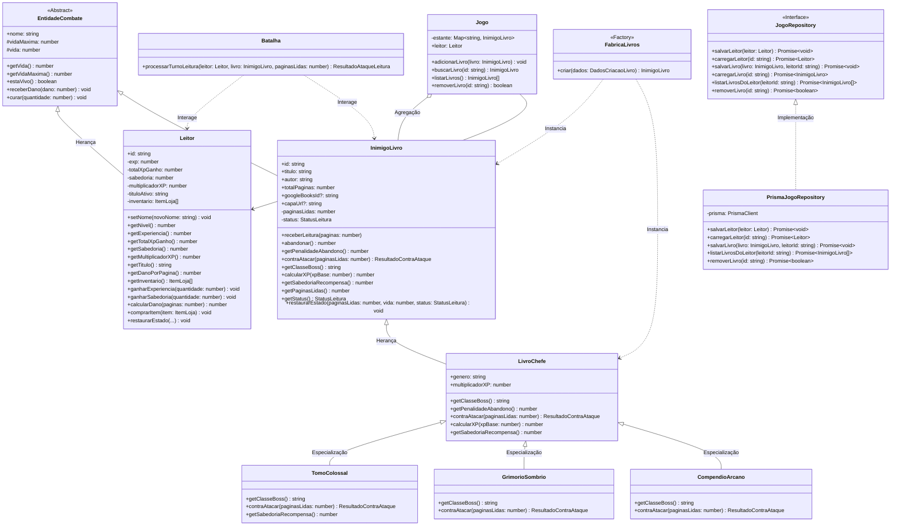

# 📚 ReadingPG: RPG Literário (R-PG)

> Transformando o hábito diário de leitura em uma aventura interativa de RPG! Cada livro se torna um **Inimigo ou Chefe (Boss)** onde a **vida total (HP) é o número de páginas** e **ler páginas reais desfere golpes** contra o monstro, gerando experiência (XP), pontos de **Sabedoria**, progressão de níveis e recompensas na Loja de Itens.

---

## 🎯 Visão Geral do Projeto

O **ReadingPG** é uma aplicação Full Stack (Backend REST em TypeScript com Deno e Prisma ORM + Frontend Reativo em React/Vite) projetada e implementada sob os pilares fundamentais da **Programação Orientada a Objetos (POO)** e boas práticas de arquitetura de software (Factory Method e Repository Pattern).

Inspirado em redes sociais de leitura e plataformas de gamificação, o sistema transforma a estante pessoal do usuário em uma arena de batalha literária contra a procrastinação.

### 🌟 Principais Recursos

- **Inimigos baseados em Livros Reais**: Cada livro adicionado à estante torna-se um adversário com pontos de vida (HP) correspondentes ao seu total exato de páginas.
- **Mecânica de Combate por Leitura**: Registrar páginas lidas causa dano direto ao HP do livro. Ao zerar a vida, a criatura literária é derrotada!
- **Sistema de Bosses e Hierarquia Polimórfica**:
  - Livros com **350+ páginas** ou selecionados pelo leitor tornam-se automaticamente **Bosses**.
  - Especializações temáticas geradas dinamicamente: **Guardião Literário**, **Tomo Colossal** (livros com 600+ páginas), **Grimório Sombrio** (terror/suspense) e **Compêndio Arcano** (livros técnicos/filosóficos), cada um com multiplicadores de XP e características únicas.
- **Contra-Ataques e Cansaço Mental**: Chefes revidam golpes causando dano de exaustão à vida/energia do herói Leitor.
- **Descanso e Recuperação**: O jogador pode recuperar vida tirando um cochilo literário ou consumindo itens como chás e cafés especiais.
- **Mecânica de Abandono**: Abandonar uma obra em andamento penaliza o leitor com dano moral decorrente da fuga da batalha.
- **Busca Resiliente com Múltiplas Contingências**: Integração com a API do **Google Books**, equipada com fallback automático para a **OpenLibrary** e um **catálogo offline**, prevenindo falhas de requisição ou limites de cota (erro 429).
- **Ajuste Customizado de Páginas**: Flexibilidade para alterar a quantidade de páginas antes de adicionar à estante, alinhando o livro à edição física do leitor.
- **Loja de Recompensas (XP & Sabedoria)**:
  - **Pontos de XP**: Utilizados para comprar poções de cura (Café Élfico, Chá de Camomila), expansão de HP Máximo (Tomo da Mente Blindada) e equipamentos com bônus de XP permanente (Óculos do Erudito, Monóculo Arcano).
  - **Pontos de Sabedoria**: Conquistados exclusivamente ao derrotar livros, permitindo desbloquear Títulos de Honra (ex: *"Rato de Biblioteca"*, *"Conquistador de Tomos"*, *"Sábio das Letras Ancestrais"*).
- **Persistência Completa de Dados**: Integração com **Prisma ORM** e banco de dados **SQLite**, salvando todo o progresso do herói, livros, estados de leitura e inventário entre sessões.
- **Interface Web Reativa e Temática**: Painel imersivo em React com tema RPG dark fantasy, barras de vida animadas, gerenciamento de estante, arena de combate e modal de edição do nome do herói.

---

## 🧱 Pilares de POO e Padrões Aplicados

| Conceito | Aplicação Prática no Projeto |
| :--- | :--- |
| **Abstração** | A classe abstrata `EntidadeCombate` define o modelo comum para seres com vida, vida máxima, aplicação de dano, cura e verificação de sobrevivência, sem acoplamento a regras específicas de heróis ou livros. No nível arquitetural, a interface `JogoRepository` abstrai totalmente as operações de banco de dados. |
| **Encapsulamento** | Atributos cruciais como `vida`, `vidaMaxima`, `exp`, `sabedoria`, `inventario`, `paginasLidas` e `status` são protegidos (`protected`) ou privados (`private`), acessados apenas via getters e modificados por métodos de domínio que garantem regras e invariantes de negócio (ex: `receberLeitura()`, `comprarItem()`, `contraAtacar()`, `abandonar()`). |
| **Herança** | `Leitor` e `InimigoLivro` herdam de `EntidadeCombate`, reaproveitando a lógica de pontos de vida. Além disso, `LivroChefe` estende `InimigoLivro`, e subclasses especializadas (`TomoColossal`, `GrimorioSombrio`, `CompendioArcano`) estendem `LivroChefe`. |
| **Polimorfismo** | Métodos como `contraAtacar()`, `calcularXP()`, `getClasseBoss()`, `getPenalidadeAbandono()` e `getSabedoriaRecompensa()` são implementados na classe base e sobrescritos com comportamentos distintos e personalizados em cada subclasse de Boss. |
| **Factory Method** | A classe `FabricaLivros` centraliza a lógica de instanciação polimórfica, analisando o número de páginas, palavras-chave de título/gênero e sinalizações de Boss para produzir a instância correta da hierarquia de livros. |
| **Repository Pattern** | O contrato `JogoRepository` desacopla a regra de negócio do mecanismo de persistência, implementado de forma assíncrona por `PrismaJogoRepository` sobre o SQLite. |

---

## 🏛️ Diagrama de Classes (POO)



---

## 🏗️ Estrutura do Projeto

```text
projeto-poo/
├── src/
│   ├── models/
│   │   ├── entidadeCombate.ts   # Classe abstrata base para entidades com vida e combate
│   │   ├── leitor.ts            # Entidade do Jogador/Herói leitor (XP, Sabedoria, Títulos, Inventário)
│   │   ├── livroModel.ts        # InimigoLivro, LivroChefe, TomoColossal, GrimorioSombrio, CompendioArcano e FabricaLivros
│   │   ├── batalha.ts           # Mecânica de combate em turnos, dano, contra-ataques e cálculo de recompensas
│   │   ├── jogo.ts              # Gerenciador da estante e sessão do jogador
│   │   ├── interfaces.ts       # Contratos, tipos (StatusLeitura, ItemLoja, ResultadoAtaqueLeitura) e interface de repositório
│   │   └── prismaRepository.ts # Implementação de persistência com Prisma ORM e SQLite
│   ├── googleBooks.ts          # Busca no Google Books + fallback OpenLibrary + catálogo offline
│   └── servidor.ts             # Servidor HTTP nativo RESTful e endpoints da API
├── frontend/                   # Interface Web Reativa (React 18 + Vite + Lucide Icons)
│   ├── src/
│   │   ├── api.js              # Camada de comunicação com a API REST
│   │   ├── App.jsx             # Telas da aplicação (Arena, Estante, Loja, Modal de Nome e Combate)
│   │   ├── styles.css          # Estilização completa com tema Dark Fantasy RPG
│   │   └── main.jsx            # Ponto de entrada do React
│   ├── package.json
│   └── vite.config.js          # Configurações do Vite e proxy reverso para a porta 3000
├── prisma/
│   ├── schema.prisma           # Modelagem de dados (Leitor e Livro) para o SQLite
│   └── dev.db                  # Banco de dados SQLite persistido
├── deno.json                   # Configurações de tasks Deno e checagem de tipos
└── README.md                   # Documentação completa do projeto
```

---

## 🔌 Especificação da API REST

Todas as rotas utilizam o prefixo `/api` e realizam comunicação com payload em **JSON**.

### 1. Usuário / Herói Leitor
- **`GET /api/usuario`**
  - Retorna o status completo do herói (vida, vida máxima, nível, XP acumulado, sabedoria, título ativo, inventário e multiplicador de XP) ou `{ precisaCadastro: true }` se não houver herói ativo.
- **`POST /api/usuario`**
  - Cadastra um novo herói ou carrega um herói já existente pelo nome.
  - *Body:* `{ "nome": "Rossi" }`
- **`PUT /api/usuario`**
  - Atualiza o nome do herói ativo no banco de dados.
  - *Body:* `{ "nome": "Rossi, o Conquistador" }`
- **`POST /api/usuario/descansar`**
  - Recupera vida/energia do leitor tirando um descanso (+15 HP).

### 2. Busca de Livros
- **`GET /api/livros/busca?q={termo}`**
  - Consulta livros na Google Books API com fallback transparente para a OpenLibrary e catálogo local em caso de erro de conexão ou cota excedida (HTTP 429).
  - Retorna lista com `id`, `titulo`, `autores`, `totalPaginas`, `descricao` e `capaUrl`.

### 3. Estante / Invocação de Livros e Monstros
- **`GET /api/estante`**
  - Retorna todos os livros na estante com HP atual, HP máximo, páginas lidas, status (`QUERO_LER`, `LENDO`, `LIDO`, `ABANDONADO`), se é Boss e classe específica do Boss.
- **`POST /api/estante`**
  - Invoca um livro na estante (como inimigo comum ou Boss via `FabricaLivros`).
  - *Body:*
    ```json
    {
      "id": "livro-123",
      "titulo": "O Hobbit",
      "autor": "J.R.R. Tolkien",
      "totalPaginas": 310,
      "capaUrl": "https://...",
      "isBoss": true,
      "genero": "Fantasia"
    }
    ```
- **`GET /api/estante/:id`**
  - Obtém os detalhes específicos de um livro na estante.
- **`POST /api/estante/:id/ler`**
  - Registra a quantidade de páginas lidas, causa dano ao livro e processa o contra-ataque do Boss (se aplicável).
  - *Body:* `{ "paginas": 30 }`
  - *Exemplo de Resposta:*
    ```json
    {
      "danoCausado": 30,
      "vidaRestanteLivro": 280,
      "livroDerrotado": false,
      "xpGanho": 90,
      "sabedoriaGanha": 0,
      "nivelAtual": 2,
      "danoRecebidoLeitor": 2,
      "vidaRestanteLeitor": 98,
      "mensagemContraAtaque": "⚔️ O Hobbit (Guardião Literário) revidou com uma onda de exaustão e causou 2 de dano!"
    }
    ```
- **`POST /api/estante/:id/abandonar`**
  - Marca o livro como `ABANDONADO` e aplica dano moral de penalidade ao herói Leitor.
- **`DELETE /api/estante/:id`**
  - Remove o livro da estante e do banco de dados (se estiver no status `LENDO`, aplica penalidade de fuga).

### 4. Loja de Recompensas (XP & Sabedoria)
- **`GET /api/loja`**
  - Retorna o saldo de XP e de Sabedoria do jogador, itens disponíveis no catálogo e inventário atual.
- **`POST /api/loja/comprar`**
  - Efetua a compra de um item, debitando o recurso apropriado (XP ou Sabedoria) e aplicando seu efeito (cura de vida, aumento permanente de vida máxima, bônus multiplicador de XP ou atribuição de título de prestígio).
  - *Body:* `{ "itemId": "cafe-elfico" }`

---

## 🛠️ Tecnologias Utilizadas

- **Linguagem Principal:** [TypeScript](https://www.typescriptlang.org/) (Strict Mode)
- **Runtime do Backend:** [Deno](https://deno.com/)
- **ORM & Banco de Dados:** [Prisma ORM](https://www.prisma.io/) com banco de dados relacional [SQLite](https://www.sqlite.org/)
- **Frontend:** [React 18](https://react.dev/) + [Vite](https://vitejs.dev/)
- **Estilização e Ícones:** CSS moderno personalizado + [Lucide React](https://lucide.dev/)
- **APIs Externas Integradas:** Google Books API e OpenLibrary API (com catálogo offline de contingência)

---

## 🚀 Como Executar o Projeto

### Pré-requisitos
- [Deno](https://deno.land/) instalado na máquina.
- [Node.js](https://nodejs.org/) (versão 18 ou superior) para executar o frontend e gerenciar dependências.

### 1. Iniciar o Backend (Deno + Prisma)
No terminal raiz do projeto:
```bash
# Inicia o servidor com recarregamento automático e variáveis de ambiente
deno task dev
```
O servidor backend iniciará em `http://localhost:3000`.

*(Opcional) Para visualizar os dados persistidos no banco de dados SQLite através do Prisma Studio:*
```bash
deno task prisma:studio
```

### 2. Iniciar o Frontend (React + Vite)
Em um segundo terminal, acesse a pasta `frontend`:
```bash
cd frontend
npm install   # apenas na primeira execução
npm run dev
```
Acesse a aplicação no navegador através do endereço: **`http://localhost:5173`**.