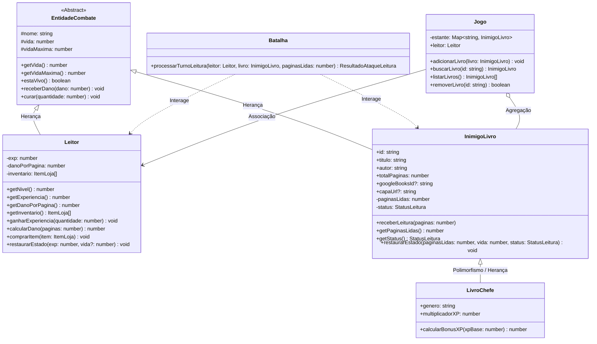

# 📚 BookQuest: RPG Literário (R-PG)

> Transformando o hábito diário de leitura em uma aventura interativa de RPG! Cada livro se torna um **Chefe (Boss)** onde a **vida total (HP) é o número de páginas** e **ler páginas reais desfere golpes** contra o monstro, gerando experiência (XP), progressão de níveis e moedas para a Loja de Itens.

---

## 🎯 Visão Geral do Projeto

O **BookQuest** é uma aplicação completa (Backend REST em Deno + Frontend Reativo em React/Vite) desenvolvida sob os conceitos fundamentais de **Programação Orientada a Objetos (POO)**. Inspirado em redes sociais de leitura como o *Skoob*, o sistema transforma a estante pessoal do usuário em uma arena de batalha.

### 🌟 Principais Recursos

- **Inimigos baseados em Livros Reais**: Cada livro adicionado à estante torna-se um inimigo/boss com HP proporcional ao seu total de páginas.
- **Mecânica de Combate por Leitura**: Registrar páginas lidas causa dano real e direto ao monstro.
- **Busca com Múltiplas Contingências**: Integração com a API do **Google Books** com fallback automático para a **OpenLibrary** e catálogo offline (evitando travamentos por limites de requisições / erro 429).
- **Ajuste Customizado de Páginas**: Permite ajustar o número de páginas antes de adicionar à estante para bater exatamente com a edição física do leitor.
- **Livros Chefes (Polimorfismo)**: Livros especiais concedem **+50% de bônus de XP** ao serem lidos e derrotados.
- **Loja de Itens (XP Shop)**: O jogador pode gastar o XP conquistado nas batalhas para comprar itens como marcadores de dano permanente, cafés de cura e tomos de vida máxima.
- **Interface Web Interativa**: Painel moderno em React com visual RPG, barras de vida animadas, seleção de livros e registro de eventos em tempo real.

---

## 🧱 Pilares de POO Aplicados

| Pilar | Como foi aplicado no projeto |
| :--- | :--- |
| **Abstração** | Criação da classe abstrata `EntidadeCombate`, isolando conceitos de combate (vida, vida máxima, recebimento de dano, cura e verificação de sobrevivência) de particularidades de jogadores ou livros. |
| **Encapsulamento** | Atributos vitais como `vida`, `vidaMaxima`, `exp` e `paginasLidas` são protegidos/privados, manipulados exclusivamente por métodos de domínio com validações de regra de negócio (`receberLeitura()`, `comprarItem()`, `receberDano()`). |
| **Herança** | `Leitor` e `InimigoLivro` herdam de `EntidadeCombate`, reaproveitando de forma limpa a lógica de pontos de vida e combate. |
| **Polimorfismo** | Especializações como `LivroChefe` estendem `InimigoLivro`, sobrescrevendo/ampliando o cálculo de recompensas com multiplicadores de XP próprios. |

---

## 🏛️ Diagrama de Classes (POO)



---

## 🏗️ Estrutura do Projeto

```text
projeto-poo/
├── src/
│   ├── game.ts             # Entidades de POO pura (EntidadeCombate, Leitor, InimigoLivro, LivroChefe, Batalha, Jogo)
│   ├── googleBooks.ts      # Integração Google Books API + Fallback OpenLibrary + Catálogo local
│   └── servidor.ts         # Servidor HTTP nativo RESTful (rotas /api/usuario, /api/estante, /api/loja, etc.)
├── frontend/               # Interface Web Interativa (React + Vite + Lucide Icons)
│   ├── src/
│   │   ├── api.js          # Camada de comunicação com a API REST
│   │   ├── App.jsx         # Telas (Arena de Combate, Estante de Livros, Loja de XP e Modal de Criação)
│   │   ├── styles.css      # Estilização com tema de RPG escuro
│   │   └── main.jsx        # Ponto de entrada React
│   ├── package.json
│   └── vite.config.js      # Proxy reverso para o backend na porta 3000
├── prisma/
│   └── schema.prisma       # Modelagem de banco de dados SQLite para persistência
├── deno.json               # Configurações de tarefas e checagem de tipos do Deno
└── README.md               # Documentação completa do projeto
```

---

## 🔌 Especificação da API REST

Todas as rotas utilizam o prefixo `/api` e comunicação em formato **JSON**.

### 1. Usuário / Herói Leitor
- **`GET /api/usuario`**
  - Retorna o status do herói atual (vida, nível, XP acumulado, dano por página e inventário) ou `{ precisaCadastro: true }` se for o primeiro acesso.
- **`POST /api/usuario`**
  - Cria ou redefine o nome do herói.
  - *Body:* `{ "nome": "Rossi" }`

### 2. Busca de Livros
- **`GET /api/livros/busca?q={termo}`**
  - Busca obras reais retornando `id`, `titulo`, `autores`, `totalPaginas` e `capaUrl`.
  - Possui fallback resiliente contra limites de requisições.

### 3. Estante / Invocação de Monstros
- **`GET /api/estante`**
  - Retorna a lista de todos os livros na estante com HP atual, HP máximo, páginas lidas e status.
- **`POST /api/estante`**
  - Invoca um livro como Boss na estante.
  - *Body:*
    ```json
    {
      "id": "livro-123",
      "titulo": "O Hobbit",
      "autor": "J.R.R. Tolkien",
      "totalPaginas": 310,
      "capaUrl": "https://...",
      "isBoss": true,
      "genero": "Fantasia"
    }
    ```
- **`POST /api/estante/:id/ler`**
  - Registra a leitura de páginas e aplica o dano ao livro.
  - *Body:* `{ "paginas": 30 }`
  - *Resposta:*
    ```json
    {
      "danoCausado": 30,
      "vidaRestanteLivro": 280,
      "livroDerrotado": false,
      "xpGanho": 90,
      "nivelAtual": 1
    }
    ```
- **`DELETE /api/estante/:id`**
  - Remove o livro da estante do jogador.

### 4. Loja de Recompensas (XP Shop)
- **`GET /api/loja`**
  - Retorna os itens disponíveis para compra e o saldo de XP do jogador.
- **`POST /api/loja/comprar`**
  - Compra um item debitando o XP do jogador e aplicando o efeito imediato/permanente.
  - *Body:* `{ "itemId": "marcador-madeira" }`

---

## 🛠️ Tecnologias Utilizadas

- **Linguagem:** [TypeScript](https://www.typescriptlang.org/) (Strict Mode)
- **Runtime do Backend:** [Deno](https://deno.com/)
- **Frontend:** [React 18](https://react.dev/) + [Vite](https://vitejs.dev/)
- **Estilização e Ícones:** CSS moderno + [Lucide React](https://lucide.dev/)
- **APIs Externas:** Google Books API & OpenLibrary API
- **Banco de Dados (Schema):** Prisma ORM / SQLite

---

## 🚀 Como Executar o Projeto

### Pré-requisitos
- [Deno](https://deno.land/) instalado na máquina.
- [Node.js](https://nodejs.org/) (versão 18+) para executar o frontend.

### 1. Iniciar o Backend (Deno)
No terminal raiz do projeto:
```bash
deno task dev
```
O servidor iniciará em `http://localhost:3000`.

### 2. Iniciar o Frontend (React + Vite)
Em outro terminal:
```bash
cd frontend
npm install   # apenas na primeira vez
npm run dev
```
Acesse a aplicação no navegador em: **`http://localhost:5173`**.
