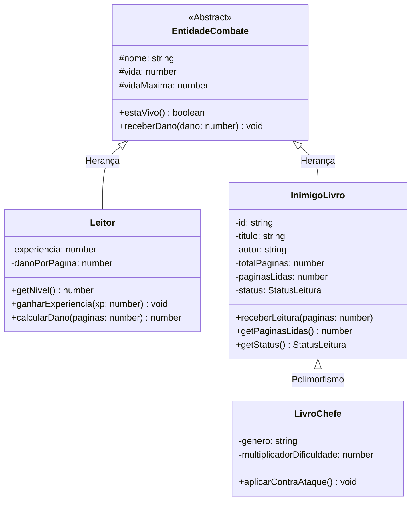

# 📚 RPG Literário: R(eading)PG

> Transformando o hábito de leitura em uma aventura de RPG! Cada livro se torna um **Chefe (Boss)**, onde a **vida total (HP) é o número de páginas** e **ler páginas desfere golpes** contra o monstro.

---

## 🎯 Visão Geral do Projeto

O **RPG Literário** é uma aplicação focada no backend desenvolvida sob os conceitos de **Programação Orientada a Objetos (POO)** e arquitetura em camadas. O sistema permite ao usuário manter uma biblioteca pessoal (inspirada no modelo do *Skoob*) e transformar suas leituras diárias em sessões de batalha contra os livros.

### 🌟 Principais Recursos
- **Inimigos baseados em Livros Reais**: Cada livro adicionado à estante torna-se um inimigo/boss com HP proporcional ao seu tamanho.
- **Mecânica de Combate por Leitura**: Registrar páginas lidas causa dano direto ao monstro.
- **Gamificação e Recompensas**: Ganho de Pontos de Experiência (XP), progressão de Níveis e bônus ao derrotar/concluir o livro.
- **Backend REST Desacoplado**: O front-end atua apenas como cliente das rotas da API.
- **Integração com APIs de Livros**: Busca e catálogo automático através da API do Google Books.

---

## 🧱 Pilares de POO Aplicados

| Pilar | Como foi aplicado no projeto |
| :--- | :--- |
| **Abstração** | Criação da classe abstrata `EntidadeCombate`, isolando conceitos de combate (vida, cálculo de dano, status de vida) de particularidades de jogadores ou livros. |
| **Encapsulamento** | Propriedades vitais como `vida`, `paginasLidas` e `experiencia` são privadas/protegidas, manipuladas exclusivamente por métodos com validação (`receberLeitura()`, `ganharExperiencia()`). |
| **Herança** | `Leitor` e `InimigoLivro` herdam de `EntidadeCombate`, reaproveitando a lógica de pontos de vida e combate. |
| **Polimorfismo** | Especializações como `LivroChefe` podem alterar o comportamento de dano recebido ou contra-atacar o leitor de acordo com o gênero e densidade da leitura. |

---

## 🏛️ Diagrama de Classes (POO)



---

## 🏗️ Estrutura Arquitetural do Back-end

```text
src/
├── domain/                    # Regras de Negócio e POO Pura
│   ├── entities/
│   │   ├── EntidadeCombate.ts # Classe base
│   │   ├── Leitor.ts          # Jogador / Perfil
│   │   ├── InimigoLivro.ts    # Livro convencional
│   │   └── LivroChefe.ts      # Especialização de livro (Boss)
│   └── repositories/
│       └── IEstanteRepository.ts
├── services/                  # Casos de Uso da Aplicação
│   ├── BatalhaService.ts      # Regra: Ler páginas -> Causar dano -> Recompensas
│   └── GoogleBooksService.ts  # Busca e extração na API do Google Books
├── infrastructure/            # Implementações externas e persistência
│   └── repositories/
│       └── JsonEstanteRepository.ts
└── presentation/              # Camada HTTP / REST
    ├── controllers/
    └── server.ts              # Rotas Express
```

---

## 🔌 Especificação da API REST

### 1. Buscar Livro na API do Google
- **Rota:** `GET /api/livros/busca?q={termo}`
- **Descrição:** Pesquisa por título, autor ou ISBN no catálogo do Google Books.
- **Exemplo de Resposta:**
```json
[
  {
    "id": "zyTCAlFPjgYC",
    "titulo": "O Senhor dos Anéis: A Sociedade do Anel",
    "autores": ["J.R.R. Tolkien"],
    "totalPaginas": 576,
    "capaUrl": "http://books.google.com/..."
  }
]
```

### 2. Adicionar Livro à Estante (Invocar Monstro)
- **Rota:** `POST /api/estante`
- **Corpo da Requisição:**
```json
{
  "id": "zyTCAlFPjgYC",
  "titulo": "O Senhor dos Anéis",
  "autor": "J.R.R. Tolkien",
  "totalPaginas": 576,
  "capaUrl": "http://..."
}
```

### 3. Visualizar Estante & Status do Jogador
- **Rota:** `GET /api/estante`
- **Exemplo de Resposta:**
```json
{
  "leitor": {
    "nome": "Aventureiro Leitor",
    "nivel": 2,
    "xp": 240
  },
  "estante": [
    {
      "id": "zyTCAlFPjgYC",
      "titulo": "O Senhor dos Anéis",
      "hpAtual": 456,
      "hpMaximo": 576,
      "paginasLidas": 120,
      "status": "LENDO",
      "derrotado": false
    }
  ]
}
```

### 4. Batalha / Registro de Leitura
- **Rota:** `POST /api/estante/:id/ler`
- **Corpo da Requisição:**
```json
{
  "paginas": 35
}
```
- **Exemplo de Resposta:**
```json
{
  "paginasLidas": 35,
  "danoCausado": 35,
  "vidaRestanteLivro": 421,
  "livroDerrotado": false,
  "xpGanho": 70,
  "nivelAtual": 2
}
```

---

## 🛠️ Tecnologias Recomendadas

- **Linguagem:** TypeScript
- **Runtime:** Node.js
- **API Framework:** Express ou Fastify
- **Persistência Inicial:** JSON / SQLite via Prisma ou Drizzle
- **Serviços Externos:** Google Books API / OpenLibrary API

---

## 🚀 Como Executar o Projeto

```bash
# 1. Clonar o repositório
git clone https://github.com/pedrodiasrossi/projeto-poo.git
cd projeto-poo

# 2. Instalar dependências
npm install

# 3. Iniciar em modo desenvolvimento
npm run dev
```
